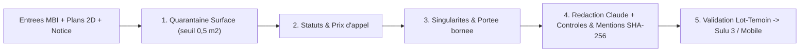

# Prototype B2 : usine de pages lots différenciées (`nexity.fr`)

Usine back-office qui transforme un flux MBI brut, les plans d'architecte 2D et la notice descriptive VEFA en fiches lots différenciées et vérifiées pour Sulu 3 / `nexity.fr` (données fictives, zéro formulaire actif).



## Démarrage rapide (`uv`)

Ouvrir directement `demo/index.html` dans Chrome (100 % autonome hors ligne), ou relancer le pipeline et l'assemblage avec `uv` :

```bash
# 1. Installer l'environnement et les outils de qualité
uv sync

# 2. Relancer le pipeline en mode cache déterministe et assembler la démo
uv run python demo/build_demo.py --run cache

# 3. Mode live avec Claude Vision + Rédaction (repli automatique sur le cache sans clé)
export ANTHROPIC_API_KEY=sk-ant-...
export B2_MODELE=claude-sonnet-5-5        # optionnel
uv run python demo/build_demo.py --run live
```

### Raccourcis clavier de la démo

| Touche / Action | Effet |
| :--- | :--- |
| `Espace` ou `→` | Étape suivante (à l'étape 5 : valide le lot témoin) |
| `←` | Revenir à l'étape précédente |
| `R` | Réinitialiser immédiatement (interrompt aussi « tout dérouler ») |
| `P` | Basculer entre l'annonce portail et la page `nexity.fr` |
| `L` | Changer de lot généré (`B31` ↔ `B12`) |
| `T` | Relancer le tour guidé des fils de preuve (étape ≥ 4) |
| `Z` / `Échap` | Agrandir / refermer le plan 2D du lot sélectionné |
| Clic lot (gauche) / étape (rail) | Inspecter n'importe quel lot du flux (`B31`, `B12`, `B22`, `A04`) ou revenir à une étape terminée |

## Scénario de démonstration (4 minutes)

| Minute | Ce que l'on montre dans le studio en place | Étape |
| :---: | :--- | :---: |
| **1** | Le programme *L'Orée Seine*, les 4 lots reçus dans la colonne MBI et leur annonce actuelle d'une ligne dans l'aperçu mobile (« Portail »). | `0` |
| **2** | **Garde-fou 1** : balayage des plans 2D, `B22` passe en `QUARANTAINE` dans le dossier central (plan `61,80 m²` vs MBI `65,00 m²` + zoom cartouche). **Garde-fou 2** : `A04` vendu est exclu, le prix d'appel affiché à gauche bascule de `269 000 €` à `279 000 €` (`B12`). | `1` et `2` |
| **3** | Singularités comparées sur le périmètre vérifié (`T3`) avec barres de comparaison, formulations non prouvées barrées et sélection du lot témoin `B31` ; puis rédaction en direct sur `nexity.fr` avec tracé SVG des fils de preuve reliant chaque phrase au plan 2D, au MBI et aux clauses de la notice descriptive. | `3` et `4` |
| **4** | Validation groupée du lot témoin `B31` depuis le bandeau d'avis (`1` relecture de ~4 min pour `2` fiches contre `72 min` en manuel), bascule `L` vers `B12`, comparaison `P` avec le portail, raccourci `T` pour les preuves et `Z` pour agrandir un plan. | `5` |

## Garde-fous implémentés face aux risques du jury

| Risque | Garde-fou dans le code | Où le vérifier |
| :--- | :--- | :--- |
| **Erreur de l'IA ou donnée MBI fausse** | Comparaison cartouche plan ↔ MBI (seuil `0,5 m²`) et somme des pièces ↔ cartouche ; quarantaine bloquante avant tout appel LLM ; rejet de tout chiffre absent du MBI, du plan ou de la notice. | Étapes `1` et `4`, `guardrails.py`, `generator.py` |
| **Promesse intenable ou superlatif non prouvé** | **Portée comparative bornée** (`evaluer_perimetre`) : tant que le flux ne couvre pas tout le stock disponible sans voisin en quarantaine (`≥ 3` lots), « le seul / du programme / de la résidence » est interdit. **Empreinte de stock liée aux voisins** (`empreinte_contexte`) : si un voisin passe `VENDU`, les fiches impactées sont invalidées et régénérées. Visuel terrasse masqué sur un lot à balcon (`B12`). | Étapes `3` et `4`, téléphone, `singularity.py`, `generator.py` |
| **Risque juridique et fiscal** | Zéro prix ni dispositif fiscal dans le texte du modèle ; prix injecté par le code ; mentions légales assemblées par identifiant avec empreinte SHA-256 vérifiée ; alerte immédiate sur prix d'appel « à partir de » caduc. | Étapes `2` et `4`, pied mobile, `legal.py` |

## Newcomer Map

| Chemin | Rôle |
| :--- | :--- |
| `pipeline/b2_pipeline/models.py` | Schémas Pydantic du flux MBI, de la notice, des mentions et de `FicheLot` |
| `pipeline/b2_pipeline/plan_reader.py` | Lecture du cartouche architecte en SVG déterministe ou via Claude Vision (PNG) |
| `pipeline/b2_pipeline/guardrails.py` | Quarantaine surface (`0,5 m²`), contrôle du prix d'appel et filtrage des lots |
| `pipeline/b2_pipeline/singularity.py` | Calcul des singularités et évaluation du périmètre de comparaison (`PerimetreComparaison`) |
| `pipeline/b2_pipeline/generator.py` | Appel Claude (outil forcé), contrôle des chiffres et de la portée, empreinte stock, cache |
| `pipeline/b2_pipeline/similarity.py` | Similarité Jaccard sur bigrammes hors mots vides (seuil d'alerte `30 %`) |
| `pipeline/b2_pipeline/legal.py` | Assemblage déterministe des mentions légales et contrôle d'intégrité SHA-256 |
| `pipeline/b2_pipeline/run.py` | Orchestration de bout en bout, invalidation sur mouvement de stock, sortie déterministe |
| `demo/template.html` | Studio Pages Lots en 3 colonnes + fils de preuve SVG, aperçu mobile interactif et zoom plan 2D |
| `demo/build_demo.py` | Assemblage idempotent de `demo/index.html` autonome hors ligne |
| `assets/data-demo/mbi_lots.json` | Extrait MBI de 4 lots T3 du programme *L'Orée Seine* |

## Développement et vérifications

```bash
uv run pytest
uv run ruff check . && uv run ruff format --check .
uv run mypy pipeline demo
```
